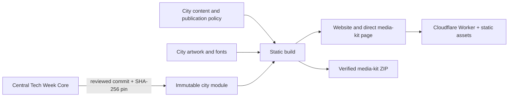

# Chennai AI Week

Chennai AI Week is a place to build, test and discuss useful AI. By Curious Commons.

Production: https://chennaiweek.com/

## Shared Core, distinct city



The shared renderer, layout rules, media-kit packaging and canonical routing live in **Tech Week Core**. `core.lock.json` records the reviewed commit and file checksums. `vendor/tech-week-core` is an immutable, public-safe distribution of that module, not an independently maintained fork. Build verification rejects local changes to the snapshot. Existing Bengaluru consumers remain on their current package version.

Update reusable behaviour in Core, run its tests, then export the city module with `node scripts/export-city-sites.mjs <city-checkout>` from a clean reviewed Core checkout. Review the pin and generated delta here. A dirty Core export is permitted for local development, but the release command rejects it.

## Work locally

Requires Node 20+, npm and Python 3. No production framework or browser JavaScript is required.

```sh
npm run build
npm run validate
npm run serve
```

Edit `config/site.json` for copy, calendar, theme and release policy. City assets stay under `assets`. The community photograph is from Bengaluru Tech Week 2026 and is visibly attributed. Retained legacy assets and download URLs are compatibility resources, not current branding.

## Media kit

Open `/media-kit/` directly. It is intentionally absent from the homepage navigation and footer, and marked noindex. Downloads include SVG/PNG marks, a white profile image, colour tokens, licensed fonts, descriptions and a readable PDF guide. The ZIP has a per-file SHA-256 inventory and an external checksum; the build tests archive integrity. PDFs are generated from `/media-kit/guide/` in Chromium print mode and reviewed before committing. Re-render the PDF when approved copy or art changes, then rebuild the ZIP. Use the actual downloadable SVG in page previews.

## Release

Validate locally and in a separate browser at desktop/mobile sizes. Push the approved batch to stage, merge stage into main through a merge-commit PR, fast-forward stage, then run npm run deploy on the clean main checkout. Wrangler uses the existing Cloudflare login and exact custom domains. No GitHub Pages deployment is used. Verify live HTTPS, canonical redirects, 404, download checksums and legacy redirects afterward.

No credentials, private operating plans, attendee records or unconfirmed speakers/partners belong in this repository.
